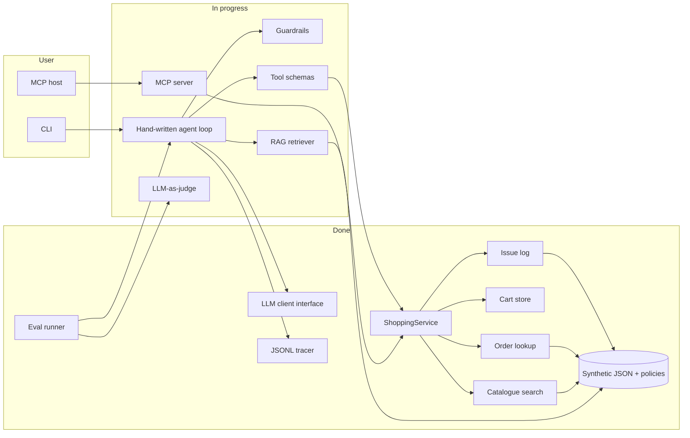

# Harbour Basket shopping assistant

I'm building a **hand-written** grocery shopping agent over a fictional
Australian supermarket catalogue. The aim is an AI commerce shopping assistant
that can help a customer find products, build a basket, check an order, and
log a missing-item or refund issue — without inventing prices, stock,
allergens, or policy.

It is **not** affiliated with any real retailer. All catalogue data, prices,
customers, orders, and policies are synthetic — see
[`data/SYNTHETIC_DATA.md`](data/SYNTHETIC_DATA.md).

## Status

Work in progress: backend, synthetic data, eval harness, tracing and CI are
done; agent loop, tool calling, RAG retriever, MCP server and LLM-as-judge
are in progress.

## Pitch

Harbour Basket is my take on an AI commerce shopping assistant: a customer
should be able to ask for products in ordinary language, get answers grounded
in a real catalogue and store policy, and take simple actions like adding to
a basket or logging a missing item.

I'm writing the agent loop by hand, with no LangChain or LangGraph, so the
tool-calling path stays inspectable. Tools will talk to a tested service
layer rather than to JSON files, which is closer to how a production agent
would call internal APIs. Retrieval is reserved for semantic and policy
questions; structured filters such as dietary tags, allergens, price and
stock stay in the catalogue search API. I'm holding the project to production
habits as I build: CI, evals as tests, tracing, guardrails, and a
provider-agnostic LLM client that already supports OpenAI, xAI Grok and Azure
OpenAI configuration.

## Quick start

Requires Python 3.11+.

```bash
python3 -m venv .venv
source .venv/bin/activate
pip install -e ".[dev]"

# Explore the synthetic catalogue (no API key required)
harbour-basket search "ripe avocado"
harbour-basket search "vegan milk" --dietary vegan --max-price 5
harbour-basket add HB-1001 --qty 2
harbour-basket cart
harbour-basket orders --customer CUST-1001
harbour-basket order ORD-5002 --customer CUST-1001

make test          # backend tests
make eval          # eval harness with a dummy (non-LLM) agent
```

To run the LLM agent once the loop is wired:

```bash
cp .env.example .env
# add OPENAI_API_KEY, or XAI_API_KEY (and LLM_PROVIDER=xai), or AZURE_OPENAI_*, or ANTHROPIC_API_KEY
harbour-basket chat "I want some ripe avocados for smashed avo"
make eval
# later: python -m shopping_agent.evals.runner --agent real
```

### Using xAI Grok

xAI's API is [OpenAI-compatible](https://docs.x.ai/docs/overview). Get a key at
[console.x.ai](https://console.x.ai/), then in `.env`:

```bash
LLM_PROVIDER=xai
XAI_API_KEY=your-key
# optional overrides; these are the defaults
# LLM_MODEL=grok-4.20-non-reasoning   # cheap, fast, tool-calling
# JUDGE_MODEL=grok-4.7                # stronger model for the LLM-as-judge
```

`get_provider_endpoint()` in `src/shopping_agent/llm/client.py` fills in
`base_url=https://api.x.ai/v1`, the key, and the model. When wiring the LLM
client, construct the official OpenAI SDK client with those values — one
implementation covers both OpenAI and Grok.

Defaults were taken from [xAI models](https://docs.x.ai/docs/models):
`grok-4.20-non-reasoning` is the documented high-speed, non-reasoning alias
($1.25 / $2.50 per 1M tokens); `grok-4.7` is the flagship judge model
($2.00 / $6.00 per 1M). To run the optional CI eval job on Grok, add an
`XAI_API_KEY` repository secret (Settings → Secrets and variables → Actions).
If that is the only chat key present, CI sets `LLM_PROVIDER=xai` automatically.

## Architecture



The important design choice: **tools talk to a real service layer**, not to
JSON files. That is closer to how a production agent would call internal APIs,
and it is why the backend is fully tested before the loop is written.

## Project layout

```
data/                  synthetic catalogue, customers, orders, policies
evals/test_cases.yaml  30 eval cases + rubrics
evals/results/         latest.md / latest.json (generated)
src/shopping_agent/
  backend/             catalogue, cart, orders, issues, ShoppingService
  agent/               loop, tools, guardrails          ← in progress
  rag/                 chunks + cosine helpers; retriever in progress
  llm/                 provider-agnostic client interface (stub)
  mcp_server/          official MCP SDK stub            ← in progress
  evals/               runner + dummy agent; judge in progress
  tracing.py           JSONL / stderr tracer (ready to hook up)
  cli.py               search / cart / orders / chat
tests/                 backend tests + skipped agent placeholders
```

## Design trade-offs

- **No LangChain / LangGraph.** A 20-line `while` loop is easier to explain in
  an interview than a framework graph, and it matches "I understand the
  tool-calling loop" better than importing one.
- **Keyword catalogue search vs RAG.** Structured filters (dietary tags,
  allergens, max price, stock) belong in the backend search API. Semantic
  questions ("when is delivery free?", "something creamy for a vegan pasta")
  belong in the retriever. Mixing them is how agents hallucinate filters.
- **Numpy index, not a vector database.** The corpus is ~200 product chunks
  plus a handful of policy sections. Cosine over a matrix is enough. See
  "What I would do in production" for the scale-up path.
- **Provider-agnostic LLM wrapper.** The loop depends on `LLMClient.complete()`
  so switching OpenAI, xAI (Grok), Azure OpenAI, or Anthropic is a factory change.
- **Evals before polish.** Tool-call agreement is scored even before the
  LLM-as-judge is implemented, so the harness can run against a dummy agent
  today and against the real loop once it lands.

## Eval results

The suite lives in [`evals/test_cases.yaml`](evals/test_cases.yaml) (30 cases:
catalogue constraints, basket building, order status, issues/refunds, policy
questions, out-of-scope, and prompt-injection).

Run `make eval` (dummy agent) or
`python -m shopping_agent.evals.runner --agent real` once the agent loop is wired.

**Results coming soon.** Scores will be pasted here from `evals/results/latest.md`
after the real agent is run against the 30-case suite.

## What I would do in production

- **Serving:** package this API + the MCP/HTTP transport, deploy to
  **Azure AKS**. Readiness probes, horizontal pod autoscaling on in-flight
  agent turns, and a tight CPU/memory budget per replica (agent turns are
  I/O bound on the model).
- **State:** the in-memory cart and issue log would become **Cosmos DB**
  (or the existing order/basket services). Product search would sit in front
  of the real catalogue API, not a JSON file.
- **Models and orchestration:** **Azure AI Foundry** for model routing
  (cheap model for classification / tool choice, stronger model for
  refunds and safety), plus managed identity instead of API keys in env vars.
- **Retrieval:** Azure AI Search or a Cosmos DB vector index, with a
  document pipeline that re-embeds when prices or policies change.
- **Observability:** keep the span/event shape in `tracing.py` and export
  to OpenTelemetry. Trace every tool call, token usage, and retrieval hit.
  Alert on tool-error rate, refusal rate, and p95 latency.
- **Evals and safety:** the 30-case set becomes a CI gate (already sketched
  in `.github/workflows/ci.yml`). Add production-log mining for new cases.
  Guardrails stay on the request path, not only in the prompt.
- **Cost / latency:** cache embeddings and frequent catalogue searches;
  cap `MAX_TOOL_ITERS`; stream the final token; use a small model for
  `search_products` and escalate for policy/refund conversations.

## Data

200 fictional products (AUD prices, dietary tags, allergens, stock), 8 sample
customers in metro Melbourne, 16 orders with statuses including delivered, in
transit, cancelled, missing item, processing, and ready for pickup, plus
policy markdown for returns, substitutions, delivery windows, and refunds.

Default demo customer: `CUST-1001` (Maya Chen, Hawthorn East). Useful orders:
`ORD-5002` (in transit), `ORD-5003` (missing butter), `ORD-5016` (click & collect,
CUST-1002).

## License

MIT. Synthetic data is covered by the same license and the notice in
`data/SYNTHETIC_DATA.md`.
