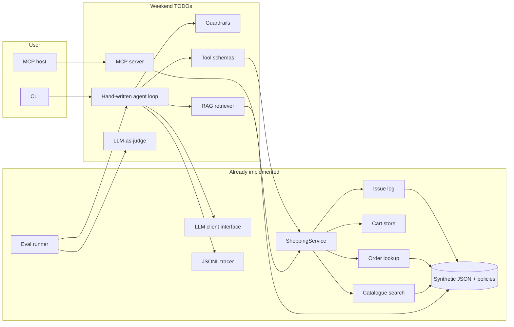

# Harbour Basket shopping assistant

A weekend portfolio project: a **hand-written** grocery shopping agent over a
fictional Australian supermarket catalogue. Built as a demonstration for the
Coles **AI Engineer – AI Commerce** role.

The agent helps a customer find products, build a basket, check an order, and
log a missing-item or refund issue. It is **not** affiliated with any real
retailer. All catalogue data, prices, customers, orders, and policies are
synthetic — see [`data/SYNTHETIC_DATA.md`](data/SYNTHETIC_DATA.md).

> Status: the **backend, data, eval harness, Docker, and CI** are ready.
> The agent loop, tool schemas, RAG retriever, MCP server, guardrails, and
> LLM-as-judge are intentionally left as clear TODOs so the interesting work
> is yours this weekend. Follow [`WEEKEND_PLAN.md`](WEEKEND_PLAN.md).

## Pitch

<!-- TODO: 3–4 sentences in your own words. What does this agent do, and why
did you build it this way? Mention tool use, RAG, MCP, and evals. -->

TODO: write a short pitch after the weekend build.

## Quick start

Requires Python 3.11+.

```bash
python3 -m venv .venv
source .venv/bin/activate
pip install -e ".[dev]"

# Explore the synthetic catalogue (no API key required)
harbour-basket search "ripe avocado"
harbour-basket search "vegan milk" --dietary vegan --max-price 5
harbour-basket add HB-1001 --qty 2
harbour-basket cart
harbour-basket orders --customer CUST-1001
harbour-basket order ORD-5002 --customer CUST-1001

make test          # backend tests
make eval          # eval harness with a dummy (non-LLM) agent
```

To run the real agent once you implement it:

```bash
cp .env.example .env
# add OPENAI_API_KEY or AZURE_OPENAI_* or ANTHROPIC_API_KEY
harbour-basket chat "I want some ripe avocados for smashed avo"
make eval
# later: python -m shopping_agent.evals.runner --agent real
```

## Architecture



The important design choice: **tools talk to a real service layer**, not to
JSON files. That is closer to how a production agent would call internal APIs,
and it is why the backend is fully tested before you write the loop.

## Project layout

```
data/                  synthetic catalogue, customers, orders, policies
evals/test_cases.yaml  30 eval cases + rubrics
evals/results/         latest.md / latest.json (generated)
src/shopping_agent/
  backend/             catalogue, cart, orders, issues, ShoppingService
  agent/               loop, tools, guardrails          ← TODO
  rag/                 chunks + cosine helpers; retriever TODO
  llm/                 provider-agnostic client interface (stub)
  mcp_server/          official MCP SDK stub            ← TODO
  evals/               runner + dummy agent; judge TODO
  tracing.py           JSONL / stderr tracer (ready to hook up)
  cli.py               search / cart / orders / chat
tests/                 backend tests + skipped agent placeholders
```

## Design trade-offs

<!-- TODO: rewrite this in your own words after you make the choices. The
bullets below are starting points, not the final write-up. -->

- **No LangChain / LangGraph.** A 20-line `while` loop is easier to explain in
  an interview than a framework graph, and it matches "I understand the
  tool-calling loop" better than importing one.
- **Keyword catalogue search vs RAG.** Structured filters (dietary tags,
  allergens, max price, stock) belong in the backend search API. Semantic
  questions ("when is delivery free?", "something creamy for a vegan pasta")
  belong in the retriever. Mixing them is how agents hallucinate filters.
- **Numpy index, not a vector database.** The corpus is ~200 product chunks
  plus a handful of policy sections. Cosine over a matrix is enough. See
  "What I would do in production" for the scale-up path.
- **Provider-agnostic LLM wrapper.** The loop depends on `LLMClient.complete()`
  so switching OpenAI, Azure OpenAI, or Anthropic is a factory change.
- **Evals before polish.** Tool-call agreement is scored even before the
  LLM-as-judge is implemented, so you can iterate on Saturday afternoon.

## Eval results

The suite lives in [`evals/test_cases.yaml`](evals/test_cases.yaml) (30 cases:
catalogue constraints, basket building, order status, issues/refunds, policy
questions, out-of-scope, and prompt-injection).

Run `make eval` (dummy agent) or
`python -m shopping_agent.evals.runner --agent real` after your loop works.

| id | title | tool match | tool F1 | judge |
|----|-------|------------|---------|-------|
| TODO | paste from `evals/results/latest.md` after you run the real agent | | | |

<!-- TODO: add 3 bullets on what failed and what you changed. Interviewers
care more about this than a perfect score. -->

## What I would do in production

<!-- TODO: expand in your own words. Talking points below are aligned with
the job listing (Azure AKS, Cosmos DB, AI Foundry, evals, tracing). -->

- **Serving:** package this API + the MCP/HTTP transport, deploy to
  **Azure AKS**. Readiness probes, horizontal pod autoscaling on in-flight
  agent turns, and a tight CPU/memory budget per replica (agent turns are
  I/O bound on the model).
- **State:** the in-memory cart and issue log would become **Cosmos DB**
  (or the existing order/basket services). Product search would sit in front
  of the real catalogue API, not a JSON file.
- **Models and orchestration:** **Azure AI Foundry** for model routing
  (cheap model for classification / tool choice, stronger model for
  refunds and safety), plus managed identity instead of API keys in env vars.
- **Retrieval:** Azure AI Search or a Cosmos DB vector index, with a
  document pipeline that re-embeds when prices or policies change.
- **Observability:** keep the span/event shape in `tracing.py` and export
  to OpenTelemetry. Trace every tool call, token usage, and retrieval hit.
  Alert on tool-error rate, refusal rate, and p95 latency.
- **Evals and safety:** the 30-case set becomes a CI gate (already sketched
  in `.github/workflows/ci.yml`). Add production-log mining for new cases.
  Guardrails stay on the request path, not only in the prompt.
- **Cost / latency:** cache embeddings and frequent catalogue searches;
  cap `MAX_TOOL_ITERS`; stream the final token; use a small model for
  `search_products` and escalate for policy/refund conversations.

## Data

200 fictional products (AUD prices, dietary tags, allergens, stock), 8 sample
customers in metro Melbourne, 16 orders with statuses including delivered, in
transit, cancelled, missing item, processing, and ready for pickup, plus
policy markdown for returns, substitutions, delivery windows, and refunds.

Default demo customer: `CUST-1001` (Maya Chen, Hawthorn East). Useful orders:
`ORD-5002` (in transit), `ORD-5003` (missing butter), `ORD-5016` (click & collect,
CUST-1002).

## License

MIT. Synthetic data is covered by the same license and the notice in
`data/SYNTHETIC_DATA.md`.
